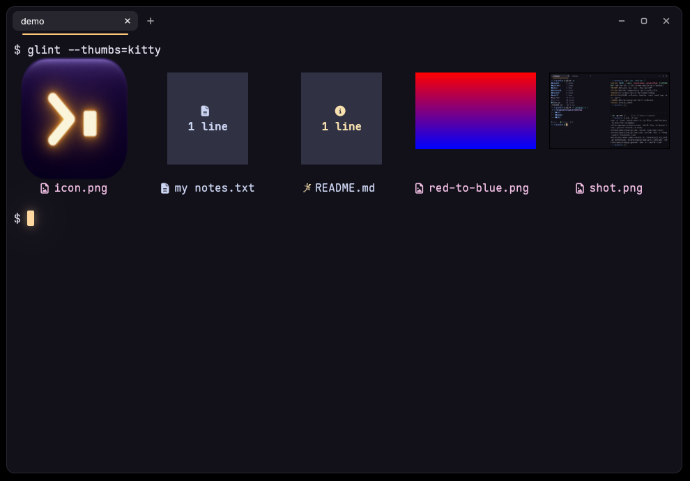
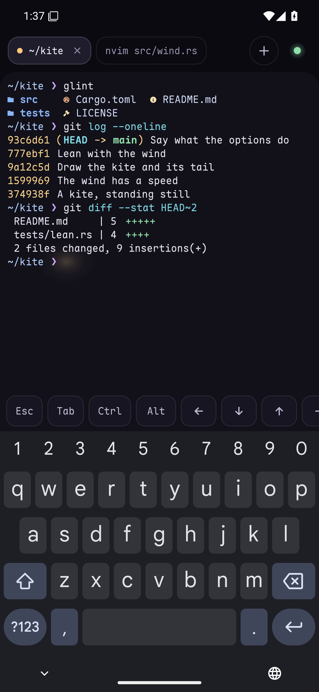

<div align="center">


# lumen

**A terminal emulator that understands what your tools print.**

[Website](https://vaspyyy.github.io/lumen/) · [Docs](https://vaspyyy.github.io/lumen/docs/) · [Release notes](https://vaspyyy.github.io/lumen/releases/)


</div>

lumen is a GPU-rendered terminal for Linux with tabs and splits built in. It is made to be the home of [glint](https://github.com/Vaspyyy/glint), crux, recap, seek and pulse: those tools print standard terminal output that works anywhere, and lumen understands more of it than other terminals do.

> **Early days.** lumen is a terminal you can work in: tabs and splits, search, a window frame of its own and a cursor that glows. The first parts that make it different are in: file names you can click and drag, inline images, and an [app for your phone](#on-your-phone) that opens terminals on your PC. Command blocks are on the roadmap below, not in the build yet.

## Install

On Linux, without root (x86_64, on a system as new as Ubuntu 22.04 or Debian 12):

```sh
curl -fsSL https://vaspyyy.github.io/lumen/install.sh | sh
```

From then on lumen updates itself, its tools (glint, crux, recap, seek, pulse, splice) and their agent skills once a day, in the background; `lumen update` does it by hand. See [Updates](https://vaspyyy.github.io/lumen/docs/install/#updates).

Every [release](https://github.com/Vaspyyy/lumen/releases/latest) also has a package for Debian and Ubuntu (`.deb`), for Fedora and openSUSE (`.rpm`) and for Arch (`.pkg.tar.zst`). [Install](https://vaspyyy.github.io/lumen/docs/install/) has the commands for each, and says how to check what you fetched. lumen runs on Wayland and X11.

To build it yourself, with a recent Rust toolchain:

```sh
git clone https://github.com/Vaspyyy/lumen
cd lumen
scripts/install.sh
```

The script builds lumen into Cargo's bin folder (`~/.cargo/bin`), adds the launcher entry and icons to `~/.local/share`, and turns on the systemd user service that keeps lumen waiting from login on and the timer that updates lumen and its tools once a day (`LUMEN_DAEMON=0` and `LUMEN_AUTO_UPDATE=0` leave them out). To only try it, `cargo run --release` is enough.

```sh
lumen                       # a window with your shell
lumen -d ~/Projects/pulse   # start in a folder
lumen -e htop               # run a program instead of the shell
```

## Opening it again

Started while a lumen runs, `lumen` doesn't start a second one: the running lumen opens a **new tab in the window you used last**, with the folder, program and environment the launch was started with, and brings it to the front. The program runs about 8 ms after the launch. `--new-window` asks for a window instead, `--new-process` for a lumen of its own, and `launch = "window"` or `"process"` in the config makes that the rule.

`lumen --daemon` is a lumen without a window that waits from login on, so that even the first window of a session draws its first frame after about 45 ms instead of 220. The install scripts install it as a systemd user service and turn it on; with a package, `systemctl --user enable --now lumen` does. [Opening lumen again](https://vaspyyy.github.io/lumen/docs/launching/) has the details.

## Keys

| Key | Does |
| --- | --- |
| `Ctrl+Shift+T` | New tab, in the folder of the current pane |
| `Ctrl+Tab`, `Ctrl+Shift+Tab` | Next and previous tab (`Ctrl+PageDown`, `Ctrl+PageUp` too) |
| `Alt+1` … `Alt+8`, `Alt+9` | Go to a tab by its place; `Alt+9` is the last one |
| `Ctrl+Shift+PageUp`, `Ctrl+Shift+PageDown` | Move the tab left or right |
| `Ctrl+Shift+D` | Split: a new pane to the right |
| `Ctrl+Shift+E` | Split: a new pane below |
| `Ctrl+Alt+Arrow` | Move to the pane in that direction |
| `Ctrl+Shift+Enter` | Let the current pane fill the tab, and back |
| `Ctrl+Shift+W` | Close the pane (the tab closes with its last pane) |
| `Ctrl+Shift+Q` | Close the tab |
| `Ctrl+Shift+C`, `Ctrl+Shift+V` | Copy and paste (`Shift+Insert` pastes too) |
| `Ctrl+Shift+F` | Search what the pane has printed. `Enter` goes to the match before, `Shift+Enter` to the one after, `Esc` closes |
| `Shift+PageUp`, `Shift+PageDown`, `Shift+Home`, `Shift+End` | Scroll back and forth |
| `Ctrl+Plus`, `Ctrl+Minus`, `Ctrl+0` | Text size of the current pane |
| `Ctrl+Shift+N` | New window, in the folder the current window was opened in |

With the mouse: drag to select (double click selects a word, triple click a line, `Ctrl`+drag a block), middle click pastes the selection, and the lines between panes can be dragged. A program that uses the mouse itself (vim, htop) gets it; hold `Shift` to select anyway. A tab closes with a middle click, and moves when you drag it onto another one.

## Files and images



**File names are files.** In a [glint](https://github.com/Vaspyyy/glint) listing made with `--hyperlink=copy` (or `hyperlink = "copy"` in glint's config), a name is a link to the file, and lumen knows what to do with it:

| On a file name | Does |
| --- | --- |
| Click | Copies the file, as a file manager's Copy does: paste it into a folder, a mail, a chat |
| `Ctrl`+click | Opens it in its program |
| Drag | Takes the file along: out of the window into another program (on Wayland), or onto a pane, which types its path |

A click copies only what the text names: a link that says one thing and leads to another file is a link like any other. Other links a program prints (web pages, `file://` links from `ls --hyperlink`) open with `Ctrl`+click. Hold `Shift` to select text that is a link. Files dragged in from a file manager are typed as their paths. Copying files needs `wl-copy` (wl-clipboard) on Wayland and `xclip` on X11.

**Images** a program sends with the [kitty graphics protocol](https://sw.kovidgoyal.net/kitty/graphics-protocol/) are drawn in place and scroll with the text: `glint --thumbs`, `kitten icat`, and other programs that speak the protocol. lumen reads PNG and raw pixels, sent in the escape sequence or as a file, at their own size or fitted to a number of cells. A pane keeps up to 320 MB of pictures (the oldest go first), and one larger than 4096 pixels on a side is scaled down. Animations and placement by placeholder characters are not there yet.

**Keys** are reported in the [kitty keyboard protocol](https://sw.kovidgoyal.net/kitty/keyboard-protocol/) to programs that ask for it, so an editor can tell `Tab` from `Ctrl+I` and `Enter` from `Shift+Enter`.

## On your phone



lumen for Android is a window to your PC. The terminals it opens run on the PC, with your shell, your tools and your files, and they keep running when you put the phone away. What you started at the desk, you pick up on the couch.

Get [lumen-android.apk](https://github.com/Vaspyyy/lumen/releases/latest/download/lumen-android.apk) on the phone (Android 11 or newer), and on the PC run:

```sh
lumen pair
```

It shows a code. Scan it with the app, compare the key both sides show, say yes on the PC. From then on the app connects by itself.

- **It logs in over SSH**, to the SSH server your PC already runs. No account, no relay, no port of lumen's own.
- **The phone's key is made in its secure hardware** and can't be copied out. It signs only after you unlocked the phone with your fingerprint or screen lock.
- **The terminals are kept by the PC.** `lumen attach --session s24-ultra-1` shows one of the phone's terminals in a window at the desk, and a terminal started with `lumen attach --session work` is in the app's list.
- **One command takes a phone out again:** `lumen unpair "Galaxy S24 Ultra"`.

[lumen on your phone](https://vaspyyy.github.io/lumen/docs/phone/) has the rest, and [How the phone logs in](https://vaspyyy.github.io/lumen/docs/phone-security/) says exactly what pairing does. `android/README.md` is about building the app.

## Configuration

lumen reads `~/.config/lumen/lumen.toml` (`lumen --config-path` prints the place). Saving the file is enough: lumen takes the change on while it runs, and says so at the bottom of the window. Everything is optional:

```toml
scrollback = 10000
copy_on_select = false
# shell = "/usr/bin/fish"   # your login shell if unset
prewarm = false             # keep one shell started, so a new tab is there at once
launch = "tab"              # `lumen` while one runs opens: tab, window, process

[font]
family = "Maple Mono"       # "monospace" is the system's fixed-width font
size = 12.0                 # in points
line_height = 1.0

[window]
opacity = 0.85              # of the background; 1 is solid
blur = true                 # blur what is behind a see-through window
padding = 10
columns = 100
lines = 30

[cursor]
style = "block"             # block, beam, underline
blink = true                # dims and comes back, never goes out
glow = true                 # the cursor gives off light
smooth = true               # the cursor glides between cells

[colors]
accent = "#ffc97a"          # lumen's own light: the line under the active tab

[colors.primary]
background = "#12111a"
foreground = "#e4e1ee"
```

With `prewarm = true`, lumen starts the shell of the next tab ahead of time, in the folder of the current pane, so a new tab shows a finished prompt the moment it opens, however long your shell takes to start. The same goes for a split. It is off by default because your shell's startup files then run before you ask for the tab (a greeter is fine; a config that attaches to tmux is not). A tab or split opened right after a `cd` still starts its shell on the spot.

The `[colors]` table has the same shape as Alacritty's (`primary`, `cursor`, `selection`, `normal`, `bright`), so a theme written for Alacritty can be pasted in unchanged. A file with a typo in it is reported: on stderr when lumen starts (it starts with its defaults), in the window when you save it while lumen runs (the settings from before stay).

## Roadmap

1. **Daily driver** (done): a terminal you can live in. Tabs, splits, selection, scrollback and search, your fonts and colors.
2. **Files and images** (done): names in a `glint` listing are objects. Click to copy, Ctrl+click to open, drag a file out into another app. Inline images through the kitty graphics protocol.
   - On the side, **your phone** (done): an Android app that opens terminals on your PC, which keep running there.
3. **Command blocks and refs** (next): jump between commands, copy one command's output, a pass or fail mark per command, and `path:line` refs from seek, recap and crux that open in your editor.

## How it works

lumen is written in Rust. The terminal itself (escape sequences, the grid, scrollback, the PTY) is [alacritty_terminal](https://crates.io/crates/alacritty_terminal), the engine of Alacritty. The window and everything drawn in it is [GPUI](https://github.com/longbridge/gpui-fast), the UI framework of the Zed editor.

An image occupies cells like text does. lumen marks each of those cells with a link of its own, so the grid scrolls, erases and overwrites an image without knowing what one is, and the drawing code looks the picture up by the mark.

```
src/
  main.rs       command line, window
  instance.rs   one lumen for all windows: launches and the daemon
  update.rs     lumen update: lumen, its tools and their skills at their newest releases
  config.rs     the config file
  terminal.rs   a running terminal: the program, its PTY, its grid
  pty.rs        the thread that reads what the program prints and writes what is typed
  graphics.rs   inline images: the kitty graphics protocol
  element.rs    draws the grid
  fonts.rs      which fonts the system has, so that none is asked for that is not there
  view.rs       a terminal on screen: keyboard, mouse, selection, clipboard, links, search
  links.rs      what a link leads to, and copying files
  keys.rs       what a key press sends to the program
  mouse.rs      mouse reports for programs that ask for them
  palette.rs    from the colors a program asks for to the theme's
  workspace.rs  tabs and splits
  actions.rs    everything a key can be bound to
  lag.rs        a record of where the time goes from a key to its frame (--features lag)
  phone/        the PC's side of the phone app: pairing, and the terminals the PC keeps
crates/
  lumen-link/   what the PC and the phone say to each other: the pairing code, the messages
  lumen-mobile/ the app's core: the SSH connection and the terminal, as a library for Android
android/        the Android app
site/           the website: the front page, the docs, the release notes
packaging/      what a release offers: the install script, the packages, the daemon's service and the update's timer; tools.txt, the tools lumen update keeps current
```

The phone app has no terminal of its own design either: its core is the same `alacritty_terminal`, fed over SSH ([russh](https://crates.io/crates/russh)) by a terminal the PC keeps running (`lumen keeper`). The screen is drawn by the app, in Kotlin.

## License

GPL-3.0-or-later. See [LICENSE](LICENSE).
