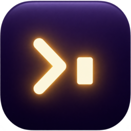
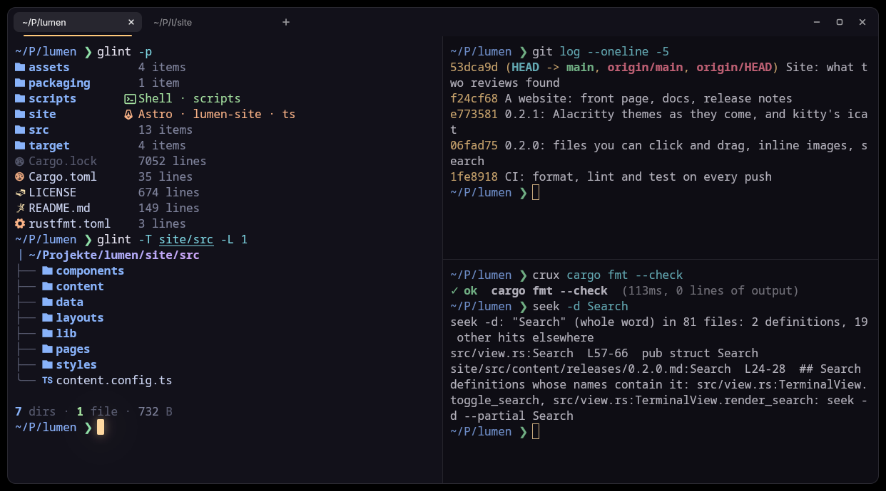

<div align="center">



# lumen

**A terminal emulator that understands what your tools print.**



</div>

lumen is a GPU-rendered terminal for Linux with tabs and splits built in. It is made to be the home of [glint](https://github.com/Vaspyyy/glint), crux, recap, seek and pulse: those tools print standard terminal output that works anywhere, and lumen understands more of it than other terminals do.

> **Early days.** lumen runs a shell, draws it correctly and has tabs and splits, a window frame of its own and a cursor that glows. The parts that make it different (files you can click and drag, inline images, command blocks) are on the roadmap below, not in the build yet.

## Install

lumen needs a recent Rust toolchain, and runs on Wayland and X11.

```sh
git clone https://github.com/Vaspyyy/lumen
cd lumen
scripts/install.sh
```

The script builds lumen into Cargo's bin folder (`~/.cargo/bin`) and adds the launcher entry and icons to `~/.local/share`. To only try it, `cargo run --release` is enough.

```sh
lumen                       # a window with your shell
lumen -d ~/Projects/pulse   # start in a folder
lumen -e htop               # run a program instead of the shell
```

## Keys

| Key | Does |
| --- | --- |
| `Ctrl+Shift+T` | New tab, in the folder of the current pane |
| `Ctrl+Tab`, `Ctrl+Shift+Tab` | Next and previous tab (`Ctrl+PageDown`, `Ctrl+PageUp` too) |
| `Alt+1` … `Alt+8`, `Alt+9` | Go to a tab by its place; `Alt+9` is the last one |
| `Ctrl+Shift+PageUp`, `Ctrl+Shift+PageDown` | Move the tab left or right |
| `Ctrl+Shift+D` | Split: a new pane to the right |
| `Ctrl+Shift+E` | Split: a new pane below |
| `Ctrl+Alt+Arrow` | Move to the pane in that direction |
| `Ctrl+Shift+Enter` | Let the current pane fill the tab, and back |
| `Ctrl+Shift+W` | Close the pane (the tab closes with its last pane) |
| `Ctrl+Shift+Q` | Close the tab |
| `Ctrl+Shift+C`, `Ctrl+Shift+V` | Copy and paste (`Shift+Insert` pastes too) |
| `Shift+PageUp`, `Shift+PageDown`, `Shift+Home`, `Shift+End` | Scroll back and forth |
| `Ctrl+Plus`, `Ctrl+Minus`, `Ctrl+0` | Text size of the current pane |
| `Ctrl+Shift+N` | New window |

With the mouse: drag to select (double click selects a word, triple click a line, `Ctrl`+drag a block), middle click pastes the selection, and the lines between panes can be dragged. A program that uses the mouse itself (vim, htop) gets it; hold `Shift` to select anyway. A tab closes with a middle click.

## Configuration

lumen reads `~/.config/lumen/lumen.toml` (`lumen --config-path` prints the place). Everything is optional:

```toml
scrollback = 10000
copy_on_select = false
# shell = "/usr/bin/fish"   # your login shell if unset
prewarm = false             # keep one shell started, so a new tab is there at once

[font]
family = "Maple Mono"       # "monospace" is the system's fixed-width font
size = 12.0                 # in points
line_height = 1.0

[window]
opacity = 0.85              # of the background; 1 is solid
blur = true                 # blur what is behind a see-through window
padding = 10
columns = 100
lines = 30

[cursor]
style = "block"             # block, beam, underline
blink = true                # dims and comes back, never goes out
glow = true                 # the cursor gives off light
smooth = true               # the cursor glides between cells

[colors]
accent = "#ffc97a"          # lumen's own light: the line under the active tab

[colors.primary]
background = "#12111a"
foreground = "#e4e1ee"
```

With `prewarm = true`, lumen starts the shell of the next tab ahead of time, in the folder of the current pane, so a new tab shows a finished prompt the moment it opens, however long your shell takes to start. It is off by default because your shell's startup files then run before you ask for the tab (a greeter is fine; a config that attaches to tmux is not). A tab opened right after a `cd`, and every split, still starts its shell on the spot.

The `[colors]` table has the same shape as Alacritty's (`primary`, `cursor`, `selection`, `normal`, `bright`), so a theme written for Alacritty can be pasted in unchanged. A file with a typo in it is reported on stderr and lumen starts with its defaults.

## Roadmap

1. **Daily driver** (in progress): a terminal you can live in. Tabs, splits, selection, scrollback, your fonts and colors.
2. **Files and images:** names in a `glint` listing become objects. Click to copy, Ctrl+click to open, drag a file out into another app. Inline images through the kitty graphics protocol.
3. **Command blocks and refs:** jump between commands, copy one command's output, a pass or fail mark per command, and `path:line` refs from seek, recap and crux that open in your editor.

## How it works

lumen is written in Rust. The terminal itself (escape sequences, the grid, scrollback, the PTY) is [alacritty_terminal](https://crates.io/crates/alacritty_terminal), the engine of Alacritty. The window and everything drawn in it is [GPUI](https://github.com/longbridge/gpui-fast), the UI framework of the Zed editor.

```
src/
  main.rs       command line, window
  config.rs     the config file
  terminal.rs   a running terminal: the program, its PTY, its grid
  element.rs    draws the grid
  view.rs       a terminal on screen: keyboard, mouse, selection, clipboard
  keys.rs       what a key press sends to the program
  mouse.rs      mouse reports for programs that ask for them
  palette.rs    from the colors a program asks for to the theme's
  workspace.rs  tabs and splits
  actions.rs    everything a key can be bound to
```

## License

GPL-3.0-or-later. See [LICENSE](LICENSE).
